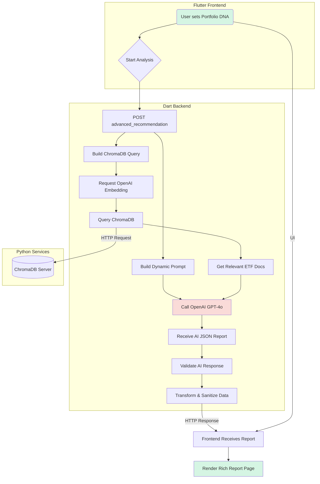

# ETF AI 智能顧問 (Flutter Edition)

這是一個由 Flutter 和 Dart 驅動的、擁有現代化使用者介面的智慧型 ETF 投資顧問。此應用程式的核心是一個進階的 AI 推薦引擎，它能根據使用者深度客製化的「投資組合 DNA」，為台灣市場的 ETF 提供由 GPT-4o 生成的個人化投資組合建議。

---

## 核心功能

- **🚀 投資組合 DNA**: 使用者不再只是選擇單一主題，而是可以透過一個引導式的流程，完整地定義自己的投資偏好：
  - **風險承受度**: 從「保守型」、「穩健型」到「積極型」的清晰選擇。
  - **主題權重**: 使用滑桿，為「高股息」、「科技/半導體」、「市值型」、「ESG」等主題分配投資權重。
  - **量化篩選**: (可選) 啟用進階設定，根據 **Beta 值**、**夏普值**等量化指標，對 ETF 進行篩選。
  - **投資組合規模**: 自訂最終希望推薦的 ETF 數量 (3-8 檔)。
- **🧠 進階 AI 分析**: 後端採用**動態提示工程 (Dynamic Prompt Engineering)**，將使用者的「投資組合 DNA」轉換為豐富的 AI 指令，驅動 GPT-4o 進行一次真正客製化的、多維度的量化分析。
- **📊 圖文並茂的報告**:
  - **互動式圖表**: 透過圓餅圖，清晰地視覺化 AI 推薦的資產配置比例。
  - **詳細持股視圖**: 可點擊任一推薦的 ETF，查看其前十大成分股的詳細分佈圖與關鍵指標表格。
  - **投資組合總覽**: 提供一個可展開的總覽，計算並顯示所有推薦 ETF 合併後，使用者資金在底層持股的最終加權分佈。
- **✨ 現代化 UI**:
  - 採用 Flutter 打造，提供流暢、跨平台一致的使用者體驗。
  - 內建精緻的、靈感來自 VS Code 的專業深色主題，以及乾淨的淺色主題，可隨時切換。

---

## 使用者故事

> **身為一位** 剛接觸投資的小資族 (Alex)，
> **我希望** 能在一個引導式的介面中，表達我「希望穩健、但又不想錯過科技股趨勢」的模糊想法，
> **以便於** 得到一份我能看得懂的、包含 3-4 檔 ETF 的具體投資組合建議，讓我能更有信心地踏出第一步。

---

### 參數調整指南：如何打造你的專屬投資 DNA？

調整不同的參數，能讓 AI 更精準地理解你的投資哲學。以下是各項參數的詳細說明，以及它們會如何影響最終的投資組合建議：

#### 1. 風險承受度

這是你投資策略的基石，決定了 AI 推薦風格的整體方向。

- **保守型**:
  - **說明**: 追求資產的穩定性與可預測性，願意為了較低的風險而接受較低的預期回報。
  - **AI 行為**: AI 將會**優先選擇**那些**歷史波動度較低**、**Beta 值較低**（例如低於 1），以及**配息較穩定**的 ETF。投資組合可能會更偏重於**非景氣循環**的產業或**債券型**資產。
- **穩健型**:
  - **說明**: 尋求風險與回報之間的平衡，願意承受一定的市場波動，以換取跟隨市場大盤成長的機會。
  - **AI 行為**: AI 將會構建一個**多元化**的投資組合，在成長型（如科技股）和價值型（如高股息）ETF 之間取得平衡，其整體的 Beta 值會趨近於 1。
- **積極型**:
  - **說明**: 追求更高的長期回報，願意為此承受顯著的市場波動與短期虧損的風險。
  - **AI 行為**: AI 將會**更偏重**於那些具有**高成長潛力**的產業（如科技/半導體）、**Beta 值較高**、以及**歷史報酬率更突出**的 ETF，而可能會降低對穩定配息的要求。

#### 2. 進階量化篩選

啟用進階篩選，能讓你像專業的基金經理人一樣，對投資組合進行更精細的微調。

- **Beta 值 (β)**:
  - **是什麼?**: 衡量一檔 ETF 相對於**整個市場**（大盤）的波動性。Beta 等於 1，代表其波動與大盤同步；大於 1，代表比大盤更劇烈；小於 1，代表比大盤更平穩。
  - **如何影響結果?**:
    - **調低 `Beta 值上限`**: AI 將會被**強制**排除掉那些波動劇烈的 ETF，讓你的投資組合整體風格更趨向**保守**或**防禦型**。
- **夏普值 (Sharpe Ratio)**:
  - **是什麼?**: 衡量投資組合**每承受一單位風險，能獲得多少超額回報**的指標。簡單來說，夏普值**越高**，代表這檔 ETF 的「**性價比**」越好。
  - **如何影響結果?**:
    - **調高 `夏普值下限`**: AI 將會被**強制**排除掉那些風險回報比不佳的 ETF，聚焦於那些在歷史數據上表現得更「**聰明**」的投資標的。

#### 3. 主題權重與投資組合規模

- **主題權重**: 這是你向 AI 表達你對特定產業**信念強度**最直接的方式。如果你將「科技/半導體」的權重設為 70%，AI 就會確保最終推薦的投資組合中，絕大部分的資金都會流向與科技相關的 ETF。
- **投資組合規模**: 調整推薦的 ETF 數量，會影響投資組合的**集中度**。
  - **較少的 ETF (例如 3-4 檔)**: 投資組合會更**集中**，優點是管理方便，缺點是風險也較集中。
  - **較多的 ETF (例如 5-8 檔)**: 投資組合會更**分散**，更能降低單一 ETF 表現不佳所帶來的衝擊。

---

## 技術架構與 RAG 流程

本專案採用基於 Dart 和 Python 的微服務架構，其核心是**檢索增強生成 (RAG)** 流程，以確保 AI 的建議是基於真實、準確的數據。



#### 流程說明

1. **前端 (Frontend)**: 使用者在 Flutter App 中，設定好個人的「投資組合 DNA」（包含風險偏好、主題權重等），並點擊「開始分析」。
2. **後端 (Backend)**: Dart Frog 伺服器接收到請求 (`/advanced_recommendation`)。
3. **動態提示工程**: 後端根據接收到的「投資組合 DNA」，動態地建立一個獨一無二的、詳細的自然語言提示 (Prompt)。
4. **RAG 檢索 (Retrieval)**: 這是 RAG 流程的核心，後端在此步驟中為 AI 準備知識庫。
   a.  **建立查詢文本 (Build Query Text)**: 後端首先將使用者的「投資組合 DNA」轉換為一個簡潔的自然語言查詢文本，例如：「為一位穩健型的投資者，尋找關於高股息、科技/半導體的 ETF」。
   b.  **文本向量化 (Request OpenAI Embedding)**: Dart 後端拿著這個**查詢文本**，向 OpenAI 的 Embedding API (e.g., `text-embedding-3-small`) 發出請求。
   c.  **獲取查詢向量 (Get Query Vector)**: OpenAI 回傳一個高維度的浮點數陣列（向量），這個向量代表了該查詢文本在語意空間中的位置。
   d.  **查詢向量資料庫 (Query ChromaDB)**: Dart 後端最終拿著這個**查詢向量**，向本地運行的 ChromaDB 伺服器發起 HTTP 請求。ChromaDB 會在已儲存的所有 ETF 向量中，執行相似度搜索，找出與查詢向量最接近的幾份 ETF 資料。
   e.  **獲取相關文件 (Get Relevant Docs)**: ChromaDB 將最相關的 ETF 資料（以純文字形式）回傳給 Dart 後端。
5. **AI 生成**: 後端將**動態提示**和從**資料庫檢索出的資料**，一同發送給 OpenAI GPT-4o，請求其生成分析報告。
6. **防禦性處理**: 後端在收到 AI 回傳的原始 JSON 後，會進行嚴格的**驗證、清洗和格式統一**，確保其結構永遠符合前端的期望。
7. **回傳與渲染**: 最終，後端將這個安全、可靠的 JSON 報告回傳給前端，前端的 `ResultPage` 負責將其渲染成使用者看到的、圖文並茂的互動式報告。

### 技術棧 (Tech Stack)

- **前端**: `Flutter` (Dart) - 打造跨平台的現代化使用者介面。
- **後端**: `Dart Frog` (Dart) - 處理業務 logique 與 API 請求。
- **AI 核心**: `OpenAI GPT-4o` - 負責生成最終的、客製化的投資分析報告。
- **向量資料庫**: `ChromaDB` (Python) - 作為 RAG 的核心，儲存並提供 ETF 數據的向量檢索。
- **資料處理層**: `Python` + `Pandas` - 負責解析來源 Excel 檔案，並建立向量資料庫。

### 資料處理與 RAG 流程詳解

1. **資料來源**: 專案所有數據的唯一事實來源是 `scripts/data/etf.xlsx` 檔案，其中包含了 ETF 的基本資料、量化因子、以及主要持股。
2. **資料處理**: `scripts/build_vector_db.py` 腳本負責讀取此 Excel 檔案。對於每一檔 ETF，它會將**所有**的欄位資訊（例如：Beta值、夏普值、主要持股等）整合成一段豐富的文字描述。
3. **向量化**: 這些豐富的文字描述，隨後被 OpenAI 的 `text-embedding-3-small` 模型轉換為高維度向量。
4. **儲存**: 最終，這些能完整代表每一檔 ETF 金融特性的向量，被儲存在 ChromaDB 中，成為 AI 的知識庫。
5. **檢索與生成**: 當使用者發出分析請求時，後端會：
   a.  將使用者的偏好轉換為一個查詢語句。
   b.  將此查詢語句進行向量化，並在 ChromaDB 中檢索出最相關的幾份 ETF 資料文件。
   c.  將使用者的完整偏好（投資組合 DNA）和檢索出的資料，一同**動態地**組合成一個極其詳細的 Prompt。
   d.  將此 Prompt 發送給 GPT-4o，生成分析報告。
6. **AI 回應的防禦性處理**: 由於大型語言模型 (LLM) 的輸出格式本質上是不可預測的，我們的 Dart 後端扮演了一個關鍵的**資料轉換與驗證層**角色。在收到 OpenAI 的原始 JSON 回應後，後端會進行嚴格的驗證、清洗和轉換，確保其結構永遠符合前端 App 預期的、穩定的格式（例如，將 `portfolio` 欄位統一轉換為列表），然後才將最終的、安全的數據回傳給前端。這是確保 App 穩健性的最後一道、也是最重要的一道防線。

---

## 架構演進之路：從探索到收斂

本專案當前簡潔的架構，並非一蹴可幾，而是經歷了多次技術探勘、原型驗證與策略迭代後的最終成果。這段歷程是我們寶貴的資產，也證明了當前架構的穩健性。

1. **v0.1 - Python 原型**: 專案最初使用 `Python` + `Streamlit` 快速搭建了一個可運作的概念驗證 (PoC) 版本，證明了以 RAG 為核心的 AI 推薦流程是完全可行的。
2. **v1.0 - 跨平台轉型**: 為了提供更現代化的使用者體驗，我們將前後端分別用 `Dart Frog` 和 `Flutter` 進行了徹底的重寫，奠定了當前微服務的基礎架構。
3. **v2.0 - 資料來源的艱難探索**: 這是專案最關鍵、也最曲折的階段。為了擴充 AI 的知識庫，我們進行了大量的資料來源探索：

   - **API 探勘**: 我們先後嘗試了 `FinMind API` 的多個版本，以及 `台灣證券交易所 (TWSE) OpenAPI`。雖然驗證了部分資料的可行性，但最終發現，沒有任何一個單一的 API 來源，能完整提供我們所需的所有核心數據（特別是 ETF 成分股）。
   - **網頁爬蟲**: 我們接著嘗試了對多個知名財經網站（`Goodinfo`, `MoneyDJ`, `Wantgoo`, `MacroMicro`）進行網頁爬蟲。但由於現代網站普遍採用了動態載入技術 (Dynamic Loading) 和日趨嚴格的反爬蟲機制，使得直接爬取資料的方案變得極不穩定且技術風險過高。
   - **第三方函式庫**: 我們也對 `yfinance` 等第三方資料函式庫進行了仲裁測試，但發現其對於台灣市場的深度資料（如成分股）支援不足。
4. **v2.1 - 回歸單一事實來源**: 在窮盡了所有外部資料獲取方案後，專案迎來了最重要的轉折：由使用者提供一份**單一、完整、權威**的 `etf.xlsx` 資料檔案。這個決策讓我們徹底擺脫了對外部服務不確定性的依賴，將專案的核心資料源，收斂到一個完全可控的本地檔案中。

最終，我們當前這個**以後端資料轉換層為核心、以前端多頁面導航為骨架、以單一本地檔案為事實來源**的簡潔架構，正是這段艱辛探索之路的最終答案。

---

## 架構演進之路：從探索到收斂

本專案當前簡潔的架構，並非一蹴可幾，而是經歷了多次技術探勘、原型驗證與策略迭代後的最終成果。這段歷程是我們寶貴的資產，也證明了當前架構的穩健性。

1. **v0.1 - Python 原型**: 專案最初使用 `Python` + `Streamlit` 快速搭建了一個可運作的概念驗證 (PoC) 版本，證明了以 RAG 為核心的 AI 推薦流程是完全可行的。
2. **v1.0 - 跨平台轉型**: 為了提供更現代化的使用者體驗，我們將前後端分別用 `Dart Frog` 和 `Flutter` 進行了徹底的重寫，奠定了當前微服務的基礎架構。
3. **v2.0 - 資料來源的艱難探索**: 這是專案最關鍵、也最曲折的階段。為了擴充 AI 的知識庫，我們進行了大量的資料來源探索：

   - **API 探勘**: 我們先後嘗試了 `FinMind API` 的多個版本，以及 `台灣證券交易所 (TWSE) OpenAPI`。雖然驗證了部分資料的可行性，但最終發現，沒有任何一個單一的 API 來源，能完整提供我們所需的所有核心數據（特別是 ETF 成分股）。
   - **網頁爬蟲**: 我們接著嘗試了對多個知名財經網站（`Goodinfo`, `MoneyDJ`, `Wantgoo`, `MacroMicro`）進行網頁爬蟲。但由於現代網站普遍採用了動態載入技術 (Dynamic Loading) 和日趨嚴格的反爬蟲機制，使得直接爬取資料的方案變得極不穩定且技術風險過高。
   - **第三方函式庫**: 我們也對 `yfinance` 等第三方資料函式庫進行了仲裁測試，但發現其對於台灣市場的深度資料（如成分股）支援不足。
4. **v2.1 - 回歸單一事實來源**: 在窮盡了所有外部資料獲取方案後，專案迎來了最重要的轉折：由使用者提供一份**單一、完整、權威**的 `etf.xlsx` 資料檔案。這個決策讓我們徹底擺脫了對外部服務不確定性的依賴，將專案的核心資料源，收斂到一個完全可控的本地檔案中。

最終，我們當前這個**以後端資料轉換層為核心、以前端多頁面導航為骨架、以單一本地檔案為事實來源**的簡潔架構，正是這段艱辛探索之路的最終答案。

---

## 未來藍圖 (Future Roadmap)

本專案的進化不會停止。以下是我們已規劃的、下一階段的架構性升級：

### **v2.2: 非同步分析與即時更新**

- **目標**: 徹底解決 AI 分析時的長等待時間問題，將使用者體驗從「同步等待」升級為「即時通知」。
- **計畫**:
  - **後端**: 將 AI 分析流程重構為**非同步背景任務**。
  - **通訊**: 引入 **WebSocket**，當背景分析完成後，由伺服器**主動將結果推送**給前端。
  - **前端**: 實現一個無須等待的 UI，使用者在點擊分析後，可以繼續操作，並在收到推送後，看到即時更新的報告。

### **v2.3: 對話式微調 (Conversational Fine-Tuning)**

- **目標**: 賦予使用者透過自然語言，對 AI 生成的初步報告進行微調的能力，實現真正的「人機協作」分析。
- **計畫**:
  - **前端**: 在報告頁面新增一個對話輸入框。
  - **後端**: 升級 AI 推薦引擎，使其能夠理解並執行後續的修改指令（例如：「加入 00878」、「排除所有債券型 ETF」、「我希望台積電的整體佔比再高一點」）。
  - **AI**: 這需要後端能夠維持一個簡短的對話歷史 (state)，並將使用者的微調指令，動態地融入到下一次的 Prompt 中，要求 AI 在原有基礎上進行修改，而非重新生成。

### **v3.0: 雲端部署與公眾存取**

- **目標**: 將整個應用程式部署到雲端平台 (GCP)，使其成為一個任何人都可以透過網址存取的公開 Web 應用。
- **計畫**:
  - **容器化**: 使用 **Docker** 將 Flutter Web、Dart 後端及 ChromaDB 三個服務，分別打包成獨立的容器。
  - **部署**: 藉助 **Google Cloud Run** 等現代化的 Serverless 平台，實現應用的自動化部署、擴展與管理。

---

## 啟動指南

本專案的運行，需要同時啟動兩個獨立的伺服器，和一個 Flutter 應用程式。

### **第一步：環境設定 (只需執行一次)**

1. **安裝 Flutter 和 Python**: 確保您的環境中已正確安裝 Flutter SDK 和 Python 3.9+。
2. **安裝 Python 依賴**: `pip install -r requirements.txt`
3. **設定環境變數**: 複製 `.env.example` 為 `.env`，並填入您自己的 `OPENAI_API_KEY`。

### **第二步：建立向量資料庫 (只需執行一次)**

1. **在終端機 1**: 啟動 ChromaDB 伺服器
   ```bash
   # 必須在專案根目錄下執行
   chroma run --path chroma_db
   ```
2. **在終端機 2**: 執行資料庫建立腳本
   ```bash
   # 在專案根目錄下執行
   build_db.bat
   ```

   *(完成後，您可以關閉此終端機。)*

### **第三步：日常運行**

1. **在終端機 1**: 啟動 ChromaDB 伺服器
   ```bash
   # 必須在專案根目錄下執行
   chroma run --path chroma_db
   ```
2. **在終端機 2**: 啟動 Dart 後端伺服器
   ```bash
   # 在專案根目錄下執行
   build_and_start.bat
   ```
3. **在終端機 3**: 啟動 Flutter 應用程式
   ```bash
   # 在專案根目錄下執行
   start_frontend.bat
   ```
